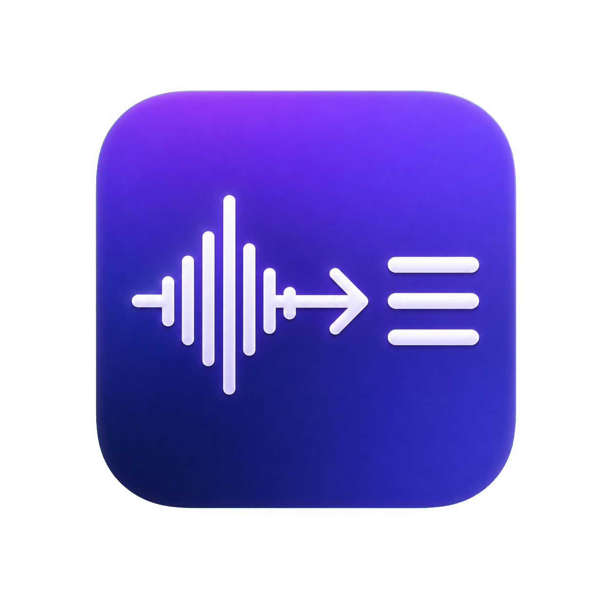
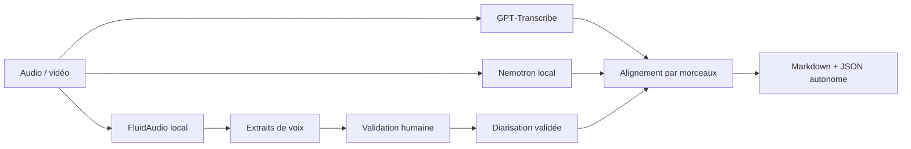

<p align="center">
  
</p>

<h1 align="center">OpenWhispr Meeting Transcriber</h1>

<p align="center">
  Transcription de réunions longue durée sur macOS avec texte GPT, diarisation locale,
  identification assistée des intervenants et reprise sans double facturation.
</p>

<p align="center">
  
  
  
  
</p>

> Adaptation privée de [OpenWhispr](https://github.com/OpenWhispr/openwhispr),
> distribuée sous sa licence MIT. Ce dépôt n’est pas un produit officiel du projet amont.

## Pourquoi ce projet ?

Les réunions réelles cumulent souvent plusieurs difficultés : enregistrements longs,
écho, voix distantes, limites de taille des API et attribution incertaine des locuteurs.
Cette adaptation sépare le travail en étapes contrôlables :

1. **FluidAudio** détecte localement les groupes de voix et produit un extrait par groupe.
2. L’utilisateur écoute les extraits et confirme les identités proposées.
3. **GPT‑Transcribe** produit le texte final français, découpé en morceaux reprenables.
4. **Nemotron 3.5 ASR Streaming** fournit les repères temporels locaux.
5. L’alignement est effectué **morceau par morceau** pour éviter la dérive sur les réunions longues.
6. Le résultat est écrit en Markdown et en JSON autonome, puis affiché dans le Finder.



## Fonctionnalités

- micro‑app SwiftUI native avec icône et lanceur macOS ;
- choix du fichier source et du dossier de destination ;
- conservation exacte du nom source (`Réunion client.mp4` → `Réunion client.md`) ;
- détection automatique de 1 à 8 groupes acoustiques ;
- extraits audio écoutables avant transcription ;
- plusieurs groupes pouvant être rattachés à une même personne ;
- profils vocaux locaux facultatifs, jamais écrits sans confirmation explicite ;
- modèles `gpt-transcribe`, GPT‑4o Transcribe, GPT‑4o Mini, Whisper‑1 et modèle diarize ;
- clé personnalisée conservée dans le Trousseau macOS ;
- découpage près des silences, cache immédiat de chaque appel réussi et reprise après échec ;
- alignement GPT ↔ Nemotron indépendant pour chaque morceau cloud ;
- sortie Markdown lisible et sidecar JSON contenant toutes les preuves de reprise ;
- nettoyage automatique des fichiers temporaires uniquement après réussite ;
- affichage du fichier terminé dans le Finder, sans l’ouvrir avec une autre application ;
- serveur MCP utilisable depuis Codex ou un autre client compatible.

## Prérequis

- macOS 13 ou supérieur sur Apple Silicon ;
- [Node.js](https://nodejs.org/) 24 (`.nvmrc` fourni) ;
- Xcode Command Line Tools / compilateur Swift ;
- `ffmpeg` (`brew install ffmpeg`) ;
- OpenWhispr installé dans `/Applications/OpenWhispr.app` pour ses runtimes natifs ;
- une clé API OpenAI disposant de crédits ;
- environ 1 Go libre pour FluidAudio, Nemotron et leurs caches locaux.

## Installation rapide

```bash
git clone git@github.com:arnaudlopez/openwhispr-meeting-transcriber.git
cd openwhispr-meeting-transcriber

nvm use
npm ci

# Compile FluidAudio et installe l’export ONNX Nemotron vérifié.
npm run transcription:setup

# Construit, signe localement et installe la micro‑app.
npm run micro-app:install

open "$HOME/Applications/OpenWhispr Transcribe.app"
```

Le build enregistre le chemin absolu du clone dans le bundle de l’application.
Après avoir déplacé le dépôt, reconstruisez la micro‑app ou définissez
`OPENWHISPR_TRANSCRIBE_ROOT` pendant le développement.

## Configurer la clé OpenAI

La méthode recommandée consiste à saisir la clé dans l’application : elle est alors
stockée dans le **Trousseau macOS**, et non dans le dépôt.

Pour un usage en ligne de commande ou via MCP :

```bash
cp .env.example .env.local
```

Puis renseignez localement :

```dotenv
OPENAI_API_KEY=
```

`.env.local`, les clés, bases vocales, enregistrements, modèles, caches et builds sont
ignorés par Git. Ne placez jamais une vraie clé dans `.env.example`.

## Utilisation de la micro‑app

1. Choisir l’enregistrement et le dossier de sortie.
2. Lancer **Analyser les voix** — cette étape est locale et gratuite.
3. Écouter les extraits, confirmer les noms ou laisser un groupe anonyme.
4. Lancer la transcription.
5. À la fin, le Finder affiche le Markdown sélectionné.

Après une réussite, l’application supprime l’analyse intermédiaire, les extraits et le
cache cloud séparé. Le JSON final reste autonome. Après un échec, ces fichiers sont
conservés afin de reprendre sans répéter les appels OpenAI déjà réussis.

## Utilisation en ligne de commande

```bash
node scripts/transcribe-meeting.mjs "/chemin/Réunion client.mp4" \
  --participants 2 \
  --speaker-labels 'speaker_00=Alice,speaker_01=Bob' \
  --no-db-write \
  --open
```

Sans `--output`, les sorties seront créées à côté de la source :

```text
Réunion client.md
Réunion client.json
```

Pour reprendre ou réaligner gratuitement depuis un résultat existant :

```bash
node scripts/transcribe-meeting.mjs "/chemin/Réunion client.mp4" \
  --openai-transcript-json "/chemin/Réunion client.json" \
  --diarization-json "/chemin/Réunion client.json" \
  --no-db-write
```

## Serveur MCP

Le serveur expose deux outils :

- `analyze_meeting_speakers` : analyse locale et extraits de voix ;
- `transcribe_meeting` : pipeline hybride complet et reprise depuis JSON.

Exemple de configuration générique :

```json
{
  "mcpServers": {
    "openwhispr-transcribe": {
      "command": "node",
      "args": [
        "/CHEMIN/ABSOLU/openwhispr-meeting-transcriber/scripts/openwhispr-transcription-mcp.mjs"
      ]
    }
  }
}
```

La clé est chargée depuis `.env.local` par le pipeline local ; elle n’a pas besoin
d’apparaître dans la configuration MCP.

## Validation

```bash
npm run transcription:test
npm run micro-app:build
```

Les tests couvrent notamment les valeurs par défaut MCP, la non‑persistance des profils,
le nommage des sorties et l’alignement indépendant des morceaux cloud.

## Arborescence utile

```text
micro-app/                         Interface SwiftUI et build macOS
scripts/analyze-meeting-speakers.mjs
scripts/fluidaudio-diarization.mjs
scripts/local-diarized-markdown.mjs
scripts/openwhispr-transcription-mcp.mjs
scripts/setup-fluidaudio-diarizer.mjs
scripts/setup-nemotron-model.mjs
scripts/transcript-alignment.mjs
patches/                           Adaptation FluidAudio / Sortformer
docs/local-diarized-markdown.md    Référence technique détaillée
```

L’architecture détaillée est décrite dans [docs/ARCHITECTURE.md](docs/ARCHITECTURE.md).
Le README original d’OpenWhispr est conservé dans
[docs/UPSTREAM_OPENWHISPR_README.md](docs/UPSTREAM_OPENWHISPR_README.md).

## Données, coût et confidentialité

- FluidAudio, Nemotron, les profils vocaux et l’alignement s’exécutent localement.
- Seuls les morceaux audio nécessaires à la transcription sont envoyés à l’API choisie.
- Chaque morceau OpenAI réussi est mis en cache immédiatement jusqu’à la réussite finale.
- Le coût dépend de la durée facturée par le fournisseur, pas du nombre de segments locaux.
- Le dépôt ne doit jamais contenir de réunions, extraits vocaux ou bases d’identités.

## Limites connues

- L’attribution exacte des locuteurs reste plus fragile que le texte sur les audios avec écho.
- Les groupes acoustiques peuvent sur‑segmenter une même personne ; l’étape humaine existe pour cela.
- Les faibles scores d’alignement par morceau doivent être vérifiés si les timestamps ou les noms sont critiques.
- Le build de la micro‑app fourni cible actuellement `arm64`.

## Modèles et licences

- Code de base OpenWhispr : MIT, voir [LICENSE](LICENSE).
- FluidAudio : récupéré et compilé par le script de setup depuis son dépôt amont épinglé.
- Nemotron : poids non inclus dans Git, téléchargés depuis l’export sherpa‑onnx épinglé ;
  consultez la licence Open Model Development and Weight License du modèle NVIDIA avant redistribution.

## Remerciements

- [OpenWhispr](https://github.com/OpenWhispr/openwhispr)
- [FluidAudio](https://github.com/FluidInference/FluidAudio)
- [sherpa‑onnx](https://github.com/k2-fsa/sherpa-onnx)
- [NVIDIA Nemotron Speech ASR](https://huggingface.co/nvidia/nemotron-3.5-asr-streaming-0.6b)
- [OpenAI Speech‑to‑Text](https://platform.openai.com/docs/guides/speech-to-text)
